<p align="center">
  
  &nbsp;&nbsp;
  
</p>

# Seheli (سهلي) — vente à crédit conforme mourabaha (MVP)

Seheli vend à crédit des téléphones et de l'électroménager à des salariés en Mauritanie : 40 % d'apport, puis 3 à
6 mensualités prélevées au versement du salaire, sans intérêt ni pénalité. Le prix est fixé à la signature et ne
change plus. Ce dépôt contient le prototype présenté au **BMCI Business Challenge** : parcours client, back-office,
tableau de bord des associés, page publique d'inscription, en français et en arabe (de droite à gauche).

L'interface est pensée mobile d'abord pour le client (installable comme une application, PWA) et pour
l'ordinateur côté back-office (menu latéral selon le rôle, tableaux triables, fiche dossier en deux colonnes,
score critère par critère). Le client suit son dossier étape par étape et voit, dans « Mon remboursement », ses
échéances payées, la prochaine échéance et le reste à payer ; les associés suivent l'encours, la concentration
des risques, les provisions et le capital sur un tableau de bord.

- Règles métier, architecture et périmètre : [`CLAUDE.md`](CLAUDE.md)
- Carte du code (modules, routes, migrations, jobs) : [`docs/CARTE.md`](docs/CARTE.md)
- Marque (logo, palette) : [`docs/MARQUE.md`](docs/MARQUE.md)

Sommaire : [Aperçu](#aperçu) · [1. Accès de démonstration pour le jury](#1-accès-de-démonstration-pour-le-jury) ·
[2. Lancement local](#2-lancement-local) · [3. Déploiement sur un VPS](#3-déploiement-sur-un-vps) ·
[4. Exploitation](#4-exploitation) · [5. Dépannage](#5-dépannage)

---

## Aperçu

Captures du profil `demo`, régénérées par `bash scripts/captures.sh` (voir [§2](#captures-décran)). Toutes les
captures : [`docs/captures/fr/`](docs/captures/fr) et [`docs/captures/ar/`](docs/captures/ar).

### Parcours client (mobile)

| Accueil | Catalogue | Suivi du dossier | Mon remboursement |
|---|---|---|---|
| 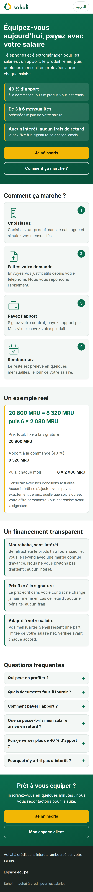 | 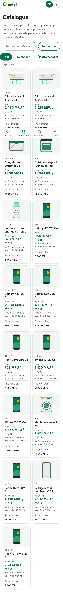 | 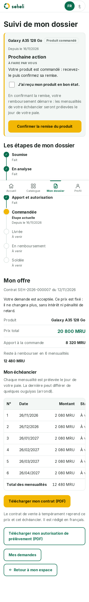 | 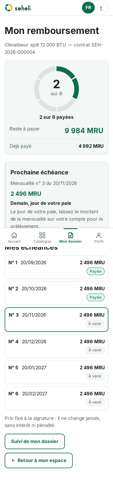 |

En arabe, la même interface s'affiche de droite à gauche :

| الصفحة الرئيسية | الكتالوج | متابعة ملفي | سدادي |
|---|---|---|---|
| 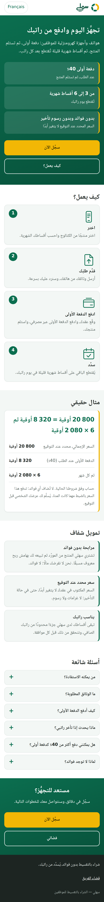 | 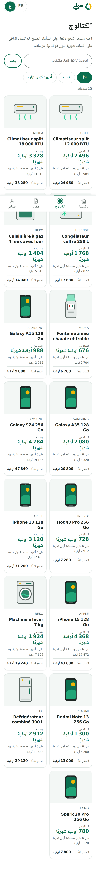 | 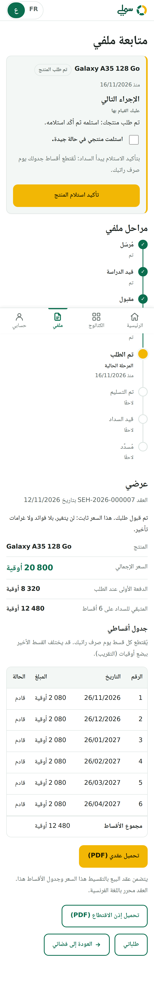 | 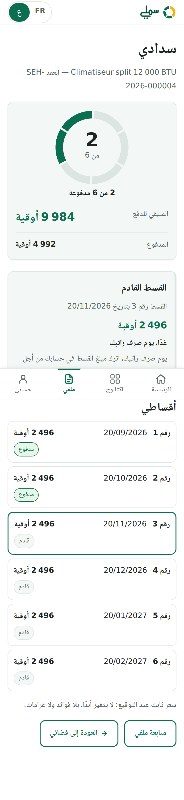 |

### Back-office (ordinateur)

| File des dossiers | Fiche dossier et score détaillé |
|---|---|
| 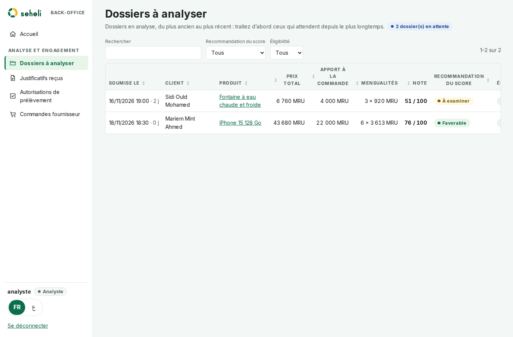 | 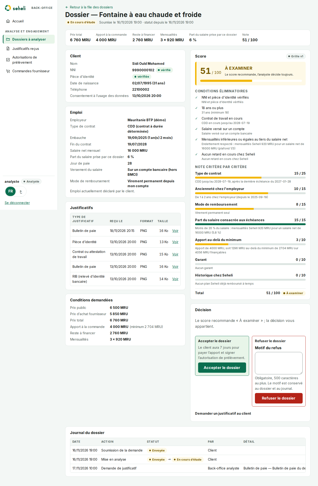 |
| **Recouvrement** | **Tableau de bord des associés** |
| 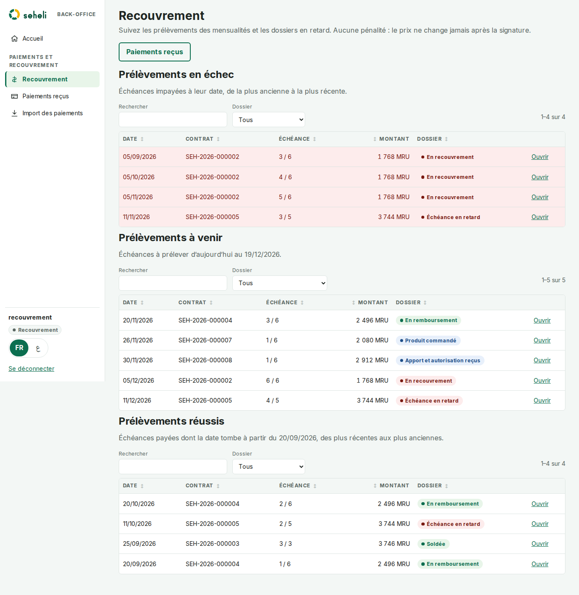 | 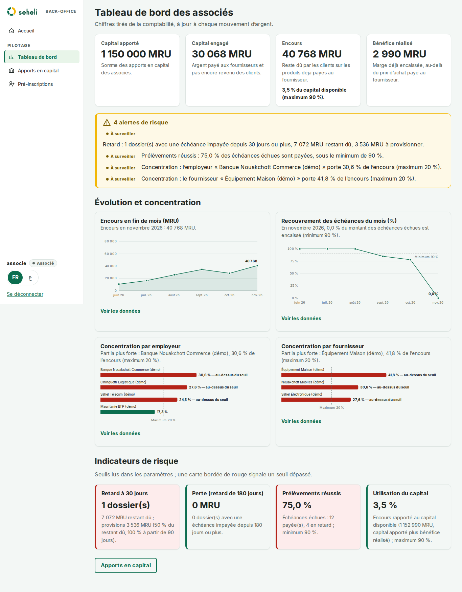 |

---

## 1. Accès de démonstration pour le jury

L'application de démonstration tourne avec le profil **`demo`** : 10 clients fictifs dans tous les états du
cycle de vie, paiements, retards, relances, un dossier soldé, apports en capital, pré-inscriptions. Les dates
sont relatives au jour du chargement : les données sont toujours « fraîches ».

### Adresses

| Espace | Chemin | Remarque |
|---|---|---|
| Accueil | `/` | choix de la langue : `?lang=fr` ou `?lang=ar` (interface en arabe, de droite à gauche) |
| Espace client | `/client` | connexion par téléphone + code à usage unique |
| Back-office | `/bo` (connexion : `/bo/login`) | identifiant + mot de passe |
| Pré-inscription publique | `/inscription` | sans compte |

En local : `http://localhost:8080`. Sur le serveur : `https://<domaine>`.

### Clients fictifs (espace client)

Saisir le numéro de téléphone, puis le code **`000000`** (en profil `demo`, le code est toujours celui-ci ;
aucun SMS n'est envoyé).

| Téléphone | Client | Dossier en cours |
|---|---|---|
| `22000001` | Client de démonstration | aucun dossier : **pour dérouler le parcours complet en direct** |
| `22100001` | Mariem Mint Ahmed | EN_ANALYSE, score FAVORABLE (un premier plan déjà soldé) |
| `22100002` | Sidi Ould Mohamed | EN_ANALYSE, justificatif demandé (une demande refusée avant) |
| `22100003` | Cheikh Ould Sidi | ACCEPTEE, autorisation signée, apport attendu |
| `22100004` | Khadijetou Mint Salem | ANNULEE (délai de 7 jours dépassé) |
| `22100005` | Mohamed Lemine Ould Abdallahi | APPORT_ET_AUTORISATION, produit à commander |
| `22100006` | Fatimetou Mint Brahim | COMMANDEE, remise à confirmer (exemple chiffré 20 000 MRU) |
| `22100007` | Ahmed Salem Ould Vall | EN_REMBOURSEMENT, après un retard régularisé |
| `22100008` | Brahim Ould Cheikh | EN_RETARD depuis ~8 jours, relances J+3 et J+7 envoyées |
| `22100009` | Oumar Ba | RECOUVREMENT, retard de plus de 30 jours (provision) |
| `22100010` | Vatimetou Mint Mahmoud | SOLDEE |

Un nouveau compte client peut aussi être créé depuis `/client/connexion/compte` (téléphone et NNI fictifs).

### Comptes du back-office (un par rôle)

| Rôle | Identifiant | Mot de passe en local | Ce qu'il voit |
|---|---|---|---|
| ANALYSTE | `analyste` | `analyste-demo` | file des dossiers, score détaillé, décision, justificatifs, autorisations de prélèvement, commandes |
| ADMIN | `admin` | `admin-demo` | catalogue (fournisseurs, produits), validation des commandes fournisseur, paiements, recouvrement, capital, inscriptions, **réinitialisation de la démo** |
| RECOUVREMENT | `recouvrement` | `recouvrement-demo` | paiements reçus (saisie, import CSV, écarts), retards, relances, recouvrement |
| ASSOCIE | `associe` | `associe-demo` | tableau de bord des associés, apports en capital (lecture), inscriptions |

Sur le serveur, les mots de passe sont ceux choisis dans le fichier `.env` (voir §3) et sont remis au jury sur
la fiche d'accès : ils ne figurent jamais dans le dépôt.

Séparation des tâches : l'analyste qui accepte un dossier ne peut pas valider le paiement fournisseur de ce
même dossier ; c'est l'ADMIN qui le fait.

### Scénario conseillé (10 minutes)

1. **Client** `22000001` / `000000` : compléter l'emploi, déposer les justificatifs (PDF, JPEG ou PNG,
   5 Mo max), choisir un produit dans le catalogue, simuler (3 à 6 mois), envoyer la demande.
2. **Analyste** : `/bo/dossiers` → ouvrir le dossier, lire le score critère par critère, accepter.
3. **Client** : `/client/dossier` → télécharger le contrat PDF et l'autorisation de prélèvement PDF ; noter
   la référence de paiement Masrvi de l'apport (format `AP…`).
4. **Analyste** : `/bo/autorisations` → déposer l'autorisation signée, la transmettre puis l'accepter.
5. **Recouvrement** : `/bo/paiements` → saisir le paiement de l'apport avec la référence `AP…` et le montant
   exact ; le dossier passe en APPORT_ET_AUTORISATION.
6. **Admin** : `/bo/commandes` → valider la commande fournisseur, télécharger le bon de commande PDF.
7. **Client** : confirmer la remise du produit ; l'échéancier s'affiche (EN_REMBOURSEMENT).
8. **Associé** : `/bo/pilotage` → encours, concentration par employeur et fournisseur, provisions, capital.

Les dossiers `22100001` à `22100010` permettent de montrer directement chaque autre état (retard,
recouvrement, dossier soldé…).

Import CSV des paiements (`/bo/paiements/import`) : trois colonnes `reference;montant;date`, en-tête
facultatif, date `2026-11-12` ou `12/11/2026`. Réimporter le même fichier n'enregistre rien deux fois.

### Remettre la démonstration à zéro

Connecté en **ADMIN** : `/bo/demonstration/reinitialisation` → la base est recréée et les données de
démonstration rechargées (environ une minute). À faire avant chaque passage devant le jury.

---

## 2. Lancement local

### Prérequis

- **JDK 25** (par exemple Eclipse Temurin 25) — `java -version` doit afficher 25.
- **Docker** avec Docker Compose (pour PostgreSQL 17).
- Maven n'est pas nécessaire : le wrapper `./mvnw` (ou `mvnw.cmd` sous Windows) le télécharge.

### Démarrage

```bash
git clone <url-du-depot> seheli && cd seheli
docker compose up -d                                   # PostgreSQL sur localhost:5432 (base, utilisateur et mot de passe : cic)
./mvnw spring-boot:run -Dspring-boot.run.profiles=demo # application sur http://localhost:8080
```

Le premier démarrage applique les migrations Flyway puis charge les données de démonstration (une à deux
minutes). Les démarrages suivants réutilisent la base.

### Profils

| Profil | Usage | Code client | Données |
|---|---|---|---|
| `demo` | présentation, jury | toujours `000000` | 10 clients fictifs + comptes back-office + bouton de réinitialisation |
| `dev` (par défaut) | développement | code aléatoire, **lu dans la console** (ligne `Notification SMS envoyée à … : …`) | catalogue de démonstration, client `22000001`, comptes back-office (mots de passe `admin-dev`, `analyste-dev`, `recouvrement-dev`, `associe-dev`) |
| `prod` | exploitation réelle | code aléatoire | aucune donnée ni compte créés automatiquement ; journaux JSON ; cookie sécurisé |

Aucun SMS ni WhatsApp n'est réellement envoyé dans le MVP : les messages sont écrits dans les journaux.

### Tests

```bash
./mvnw test                         # suite complète (tests unitaires, sans base)
./mvnw -q test -Dtest=NomDuTest     # une seule classe
```

### Repartir d'une base vide en local

```bash
docker compose down -v && docker compose up -d
```

### Variables d'environnement utiles (toutes facultatives en local)

| Variable | Rôle | Défaut |
|---|---|---|
| `SPRING_DATASOURCE_URL`, `SPRING_DATASOURCE_USERNAME`, `SPRING_DATASOURCE_PASSWORD` | base PostgreSQL | `jdbc:postgresql://localhost:5432/cic`, `cic`, `cic` |
| `SEHELI_BO_<ROLE>_IDENTIFIANT`, `SEHELI_BO_<ROLE>_MOT_DE_PASSE` (`ADMIN`, `ANALYSTE`, `RECOUVREMENT`, `ASSOCIE`) | comptes back-office créés au démarrage (`dev`, `demo`) s'ils n'existent pas | voir tableau ci-dessus |
| `SEHELI_CLIENT_DEMO_TELEPHONE`, `SEHELI_CLIENT_DEMO_NNI` | client de démonstration | `22000001`, `9990000001` |
| `SEHELI_DOCUMENTS_REPERTOIRE` | justificatifs déposés | `~/.cic/justificatifs` |
| `SEHELI_AUTORISATIONS_REPERTOIRE` | autorisations de prélèvement signées | `~/.cic/autorisations-signees` |

Un compte back-office déjà créé garde son mot de passe : changer la variable ne le modifie pas (repartir d'une
base vide ou réinitialiser la démonstration).

### Captures d'écran

`bash scripts/captures.sh` capture en PNG les écrans clés (pages publiques, parcours client, back-office par rôle),
en français et en arabe, dans `docs/captures/fr/` et `docs/captures/ar/`. L'application doit tourner en profil
`demo` sur une base fraîche ou réinitialisée (URL : `SEHELI_CAPTURES_URL`, défaut `http://localhost:8080`).
L'outil est un petit projet Maven séparé (`scripts/captures/`, Playwright pour Java : ni Node ni dépendance
ajoutée à l'application) ; au premier lancement, il télécharge Chromium dans `~/.cache/ms-playwright`.
Chromium a besoin des bibliothèques système habituelles (paquets `libnss3`, `libgbm1`, `libasound2t64`…) et
d'une police arabe (`fonts-noto-core`).

### Ancien nom « CIC » conservé dans quelques noms techniques

Le projet s'appelait CIC avant de devenir Seheli. Pour ne perdre aucune donnée sur un serveur déjà installé,
l'ancien nom reste volontairement dans : la base de données et son utilisateur (`cic`), le nom du projet Docker
Compose (`name: cic`, donc les volumes `cic_*`), les migrations Flyway déjà appliquées, les clés de la table
`parametre` (`cic.compte.*`, `marge.cic.defaut.pct`…), les répertoires `~/.cic/` et les numéros des contrats
établis avant le renommage (`CIC-AAAA-NNNNNN`). Tout ce que voient les clients et l'équipe dit « Seheli ».

---

## 3. Déploiement sur un VPS

L'image Docker est construite sur le serveur ; trois services tournent : **PostgreSQL**, **l'application**
(port 8080, jamais publié) et **Caddy**, qui obtient seul le certificat HTTPS Let's Encrypt. Un quatrième
service fait une sauvegarde quotidienne de la base.

### Prérequis

- Un VPS Linux (Ubuntu 24.04 ou Debian 12 conseillés), **2 Go de RAM minimum** (4 Go confortables pour la
  compilation), 10 Go de disque.
- Un nom de domaine dont l'enregistrement **A** (et AAAA si IPv6) pointe vers l'IP du VPS.
- Ports **80** et **443** (TCP, et 443/UDP pour HTTP/3) ouverts dans le pare-feu de l'hébergeur.

### Étapes

```bash
# 1. Docker (script officiel) et git
curl -fsSL https://get.docker.com | sudo sh
sudo apt-get install -y git
sudo usermod -aG docker "$USER" && newgrp docker

# 2. Pare-feu (si ufw est utilisé)
sudo ufw allow OpenSSH && sudo ufw allow 80/tcp && sudo ufw allow 443/tcp && sudo ufw allow 443/udp && sudo ufw enable

# 3. Code
git clone <url-du-depot> seheli && cd seheli

# 4. Configuration : copier le modèle puis remplacer chaque A_CHANGER
cp .env.example .env
chmod 600 .env
nano .env

# 5. Construction et démarrage (le .env fixe COMPOSE_FILE=docker-compose.prod.yml)
docker compose up -d --build

# 6. Suivi du démarrage (migrations, chargement de la démo, certificat)
docker compose ps
docker compose logs -f app caddy
```

Dans `.env` :

- `SEHELI_DOMAINE` : le nom de domaine public (par exemple `seheli.exemple.mr`) ;
- `SPRING_PROFILES_ACTIVE=demo` pour le jury (données fictives, code `000000`, réinitialisation) ;
  `prod` pour une exploitation réelle ;
- `DB_PASSWORD` et les quatre `SEHELI_BO_*_MOT_DE_PASSE` : des mots de passe longs et distincts, par exemple
  générés avec `openssl rand -base64 18`. Ce sont eux qu'on remet au jury.

Le site est prêt quand `docker compose ps` affiche `app` en `healthy` (une à trois minutes au premier
démarrage) : ouvrir `https://<domaine>`. Vérification : `curl -s https://<domaine>/actuator/health` renvoie
`{"status":"UP"}`.

Essai du déploiement complet sur un poste : laisser `SEHELI_DOMAINE=localhost`, puis ouvrir
`https://localhost` (certificat de l'autorité interne de Caddy, à accepter dans le navigateur).

Sans nom de domaine : `SEHELI_DOMAINE=VOTRE_IP.sslip.io` (ports 80 et 443 ouverts), puis
`docker compose up -d --force-recreate caddy` ; détails dans [docs/DEPLOIEMENT.md](docs/DEPLOIEMENT.md).
Serveur installé avant le renommage en Seheli : suivre la section « Passer de CIC à Seheli sur un serveur
existant » du même guide (renommage des variables du `.env`, volumes conservés).

### Mise à jour

```bash
cd seheli
git pull
docker compose up -d --build
```

Les migrations Flyway s'appliquent au démarrage ; les volumes (base, justificatifs, certificats, sauvegardes)
sont conservés.

### Profil `prod`

Le profil `prod` ne crée ni données ni comptes back-office, et le MVP n'a pas d'écran de gestion des comptes.
Pour une mise en service réelle, créer les comptes directement dans la table `utilisateur_back_office`
(un rôle par compte, mot de passe haché en BCrypt) :

```bash
docker compose exec db psql -U cic -d cic -c "INSERT INTO utilisateur_back_office (id, identifiant, mot_de_passe_hash, role)
  VALUES (gen_random_uuid(), 'admin', '<hachage BCrypt>', 'ADMIN');"
```

(le hachage s'obtient par exemple avec `htpasswd -bnBC 10 "" '<mot de passe>' | tr -d ':\n'`). Ne pas démarrer
en `demo` ou `dev` sur une base réelle : ces profils créent des données fictives. Dans le cadre du challenge,
le serveur tourne en `demo`.

---

## 4. Exploitation

| Besoin | Commande (dans le répertoire `seheli` du serveur) |
|---|---|
| État des services | `docker compose ps` |
| Journaux de l'application (JSON) | `docker compose logs -f app` |
| Redémarrer l'application | `docker compose restart app` |
| Arrêter / relancer tout | `docker compose down` / `docker compose up -d` |
| Sauvegarde immédiate | `docker compose exec sauvegarde bash /usr/local/bin/sauvegarde-base.sh` |
| Lister les sauvegardes | `docker compose exec sauvegarde ls -lh /sauvegardes` |
| Copier les sauvegardes hors du serveur | `docker compose cp sauvegarde:/sauvegardes ./sauvegardes` |
| Réinitialiser la démo | back-office ADMIN → `/bo/demonstration/reinitialisation` |
| Repartir de zéro (**efface tout**) | `docker compose down -v && docker compose up -d --build` |

Sauvegarde automatique : chaque jour à `SAUVEGARDE_HEURE` (UTC), conservée `SAUVEGARDE_RETENTION_JOURS` jours,
dans le volume `sauvegardes`. Les justificatifs déposés sont dans le volume `justificatifs`.

Restauration d'une sauvegarde :

```bash
docker compose stop app
docker compose exec sauvegarde sh -c 'pg_restore --clean --if-exists --no-owner -d "$PGDATABASE" /sauvegardes/cic-AAAAMMJJ-HHMMSS.dump'
docker compose start app
```

Les paramètres métier (apport minimum, marge, durées, seuils de risque…) sont dans la table `parametre` et
relus toutes les 5 minutes : ils se modifient sans redéploiement.

---

## 5. Dépannage

| Symptôme | Cause probable et solution |
|---|---|
| `release version 25 not supported` | le JDK n'est pas en version 25 : installer Temurin 25 et vérifier `JAVA_HOME`. |
| `Connection refused … 5432` en local | PostgreSQL n'est pas démarré : `docker compose up -d`, puis `docker compose ps`. |
| Port 5432 ou 8080 déjà pris | arrêter l'autre PostgreSQL / l'autre application, ou changer le port dans `docker-compose.yml` / `--server.port=8081`. |
| `./mvnw: Permission denied` ou `bad interpreter` | `chmod +x mvnw && sed -i 's/\r$//' mvnw` (dépôt cloné sous Windows). |
| `… manquant dans .env` au `docker compose up` | une variable obligatoire n'est pas renseignée dans `.env`. |
| Pas de certificat HTTPS | le DNS ne pointe pas encore vers le VPS, ou les ports 80/443 sont fermés : `docker compose logs caddy`. |
| `app` reste `starting` puis `unhealthy` | lire `docker compose logs app` ; avec 1 Go de RAM, la compilation ou le démarrage peut échouer : ajouter du swap ou prendre 2 Go. |
| Code client refusé en profil `dev` | le code est aléatoire : le lire dans la console de l'application. En `demo`, c'est `000000`. |
| Mot de passe back-office refusé après changement du `.env` | le compte existait déjà : réinitialiser la démo ou repartir d'une base vide. |
| Chargement de la démo interrompu | réinitialiser la démonstration (ADMIN) ou repartir d'une base vide. |
